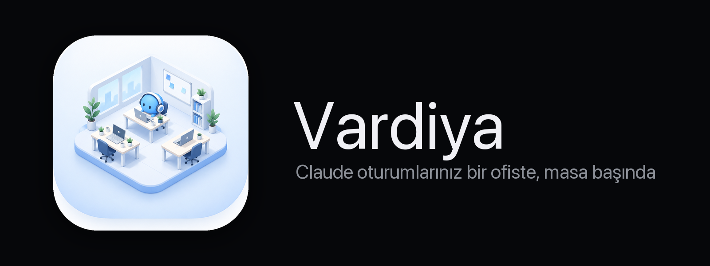

<p align="center"></p>

<p align="center">
  
  
  
  
</p>

# Vardiya

Açık olan bütün Claude Code oturumlarınızı izometrik bir ofiste, masa başında çalışan karakterler olarak gösteren macOS uygulaması.

- Her proje bir oda; o projedeki her oturum ve alt ajan bir masa.
- Karakterin üstündeki balon o anki işi gösterir: okuyor, yazıyor, komut çalıştırıyor, iş dağıtıyor, onay bekliyor, emir bekliyor, bitti.
- Ana ajandan alt ajanlara kesikli iş aktarım çizgisi çekilir.
- Sağ panelde seçili çalışanın modeli, bağlam boyutu, token sayısı ve son işleri görünür.
- Menü çubuğunda kaç ajanın çalıştığı ve kaçının sizi beklediği yazar.

## 3D ofis

RealityKit ile çizilen gerçek bir 3D sahne (üstteki "3D / Sade" seçimiyle 2D görünüme geçilebilir).

- Kenney'nin CC0 mobilya ve karakter paketleri; her ajan farklı bir karakter.
- Ajanlar yaptıkları işe göre poz alır: yazar, okur, komut çalışırken arkasına yaslanır, düşünürken eli çenesinde, onay beklerken el kaldırır.
- Uzun süre emir bekleyen ajan mola verir: kahve, sebil, kanepe, lavabo (tek kişilik, kapılı, içerisi sansürlü 😄); öğle arasında yemek masasına oturur. İş gelince koşarak masasına döner.
- Art arda 3 hata alan ajan ayağa kalkıp grev yapar.
- Aynı iş uzadıkça sinirlenir: 1 dk'da 😤, 2 dk'da sansürlü küfür balonu (🤬 #@%&!) ve masaya yumruk, 4 dk'da daha da hiddetli.
- Mesajınız kapıdan çıkan ışıklı bir zarfla ajana uçar; yanıtı balonda görünür.
- Kantindeki sunucu kabini ofisin "interneti": web araması, tarayıcı ya da MCP aracı kullanan ajanın masasından kabine yeşil, paketli bir bağlantı uzanır. Çalışan alt ajanla ana ajan arasında mor bağlantı durur.
- Gün/gece döngüsü gerçek saate bağlı: gece avizeler yanar, çalışan masaların lambası açılır.
- Ofisin çevresi: çimenli bahçe, ağaçlar ve çiçekler, solda müstakil evler, arkada sokak lambalı cadde ve park etmiş arabalar, karşıda ofis binaları ve gökdelenler, ufukta şehir silueti. Gece pencereler ve sokak lambaları yanar, gökyüzü saate göre renk değiştirir. Ajanlar kapıdan taş yolla kaldırıma çıkıp gelir.
- Sağ üstteki panel düğmesi (⌥⌘0) sağ paneli gizleyip ekranı sahneye bırakır.
- Kamera: sürükle = döndür, ⌥/sağ tıkla sürükle veya iki parmak kaydır = kaydır, kıstır/tekerlek = imlece doğru yakınlaş, çift tık = tüm ofis; ajana tıklayınca kamera onu takip eder. Hazır açılar: izometrik, kuş bakışı, önden.
- Ajanın ne yaptığı ayrıntılı: kod inceliyor/yazıyor, belge okuyor/yazıyor, görsele bakıyor, derliyor, test ediyor, git, web araması, ekran görüntüsü. Monitörde buna göre kayan kod, belge ya da görsel görünür.
- Sohbet penceresi: bir oturumla aranızdaki konuşmanın tamamı; araç adımları gruplanır, ajan çalışırken yazdığınız mesaj "Sırada" balonuyla hemen görünür, pencere en yeni mesajlardan açılır. Dosya/görsel sürükleyince yolu eklenir.
- Oturumu kapat: onay sonrası Claude'a `/exit` gönderilir, süreç kapanınca sekme kapatılır.

## Terminale mesaj gönderme

Sohbet penceresinden yazdığınız mesaj, oturumun iTerm2 sekmesine sizin yazmışsınız gibi gider. Sekme, Claude sürecinin terminal hattı (`ps -o tty`) ile iTerm2 oturumunun `tty` özelliği eşleştirilerek bulunur.

Gönderim sırası:

1. Metin `write text … newline no` ile yazılır.
2. ~0,9 sn beklenip yalnızca Enter (CR) gönderilir.
3. Sekmenin ekranı okunur; giriş kutusu (`❯` satırı) boşaldıysa bitti.
4. Boşalmadıysa bir Enter daha denenir.
5. O da olmazsa son çare olarak iTerm2 bir anlığına öne alınıp gerçek Enter tuşuna basılır ve odak Vardiya'ya geri verilir.

Neden böyle: iTerm2 metni ve Enter'ı olduğu gibi gönderiyor (ölçüldü: `abc^Mdef^M`, yapıştırma kaçışı yok), ama Claude Code hızlı gelen karakter yığınını yapıştırma sayıp hemen ardından gelen Enter'ı satır sonu olarak yorumluyor. Bekleme bu pencereyi kapatıyor; ekran kontrolü de mesajın kutuda kalmadığından emin oluyor.

İlk kullanımda macOS iTerm2'yi kontrol etmek için otomasyon izni, son çare yolu için de Erişilebilirlik izni ister. Terminal.app kullanılıyorsa `do script` ile gönderilir.

## Veri nereden geliyor

Claude Code'un ayarlarına dokunulmaz, hook kurulmaz. Uygulama yalnızca okur:

- `~/.claude/sessions/<pid>.json`: canlı oturum kaydı (çalışıyor/boşta)
- `~/.claude/projects/<proje>/<oturum>.jsonl`: oturum dökümü (araç çağrıları, token kullanımı, başlık)
- `~/.claude/projects/<proje>/<oturum>/subagents/`: alt ajan dökümleri

Dökümler artımlı okunur; her saniye yalnızca yeni satırlar işlenir.

## Derleme

```sh
brew install xcodegen
xcodegen generate
xcodebuild -project Vardiya.xcodeproj -scheme Vardiya -configuration Debug -derivedDataPath build build
open build/Build/Products/Debug/Vardiya.app
```

3D varlıkları yeniden üretmek için: `python3 scripts/build_assets.py`. Kenney paketlerini indirir, mobilyaları USDZ'ye çevirir, karakterleri eklem parçalarına ayırır ve animasyonları `animations.json`'a çıkarır. Yeni model eklediyseniz ardından `xcodegen generate` çalıştırın.

Debug derlemesinde test parametreleri:

- `-vardiyaHour 22.5`: ofis saatini değiştirir (gece, öğle arası).
- `-vardiyaFastBreaks YES`: molalar birkaç saniye içinde başlar.
- `-vardiyaSpot toilet|water|sofa|coffee|lunch`: mola yerini zorlar.
- `-vardiyaFocus 3`: kamerayı 3. ajana odaklar.
- `-vardiyaZoom 3`: açılışta kamerayı uzaklaştırır (çevreyi görmek için).

## Lisans

MIT · © 2026 Rodosgrup Yazılım Ekibi. Ayrıntı için [LICENSE](LICENSE).

3D modeller: [Kenney](https://kenney.nl) Mini Characters, Furniture Kit, Nature Kit, City Kit (Commercial, Suburban, Roads) ve Car Kit, CC0 (`Vardiya/Resources/Models/LICENSE-kenney.txt`).
